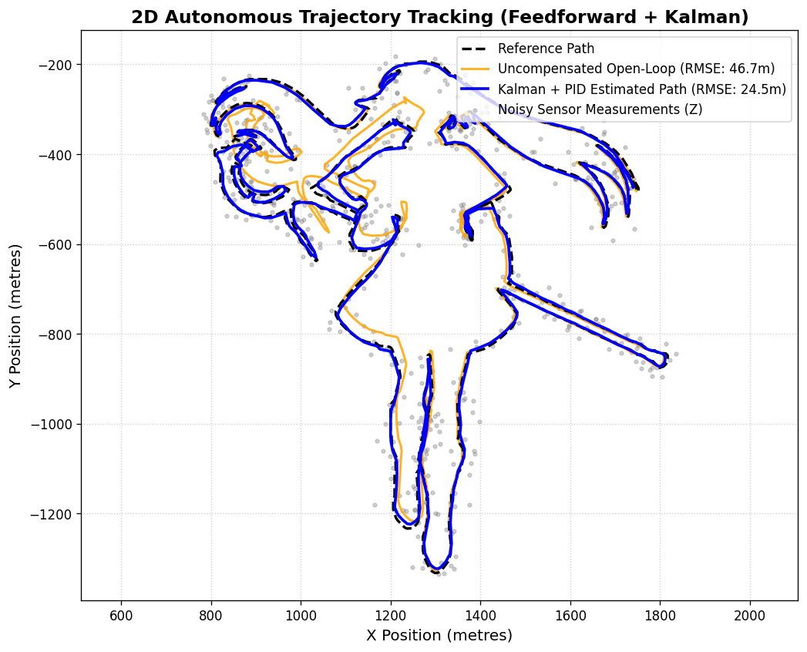

# 2D Autonomous Trajectory Tracker & State Estimator

A rigorous Python-based simulation framework implementing a discrete-time **Linear Kalman Filter** combined with a **Closed-Loop PID Controller** and **Path-Curvature Feedforward Acceleration** to execute autonomous 2D trajectory tracking along complex parametric paths (e.g., high-resolution vector outline extractions).

## 📊 Visual Results

<p align="center">
  
  <br>
  <em>Figure 1: Benchmark comparison showing uncompensated open-loop drift vs. closed-loop Kalman + PID tracking along the parametric reference path.</em>
</p>


## 🧠 System Architecture & Methodology

This project simulates a 2D point-mass agent navigating a predefined trajectory subject to both physical disturbances (process noise) and measurement inaccuracies (sensor noise).

### 1. State-Space Kinematics & Corrected Noise Modeling

The agent's state vector is defined by its 2D position and velocity:

$$
\mathbf{x}_k = \begin{bmatrix} x_k & y_k & \dot{x}_k & \dot{y}_k \end{bmatrix}^T
$$

Using discrete-time SUVAT kinematics over time step $\Delta t$, the system evolves via the state transition matrix $\mathbf{F}$ and control input matrix $\mathbf{B}$:

$$
\mathbf{x}_{k+1} = \mathbf{F}\mathbf{x}_k + \mathbf{B}\mathbf{u}_k + \mathbf{w}_k, \quad \mathbf{w}_k = \mathbf{B}\boldsymbol{\eta}_k, \quad \boldsymbol{\eta}_k \sim \mathcal{N}(\mathbf{0}, \sigma_{\text{process}}^2 \mathbf{I})
$$

$$
\mathbf{F} = \begin{bmatrix} 1 & 0 & \Delta t & 0 \\ 0 & 1 & 0 & \Delta t \\ 0 & 0 & 1 & 0 \\ 0 & 0 & 0 & 1 \end{bmatrix}, \quad \mathbf{B} = \begin{bmatrix} \frac{1}{2}\Delta t^2 & 0 \\ 0 & \frac{1}{2}\Delta t^2 \\ \Delta t & 0 \\ 0 & \Delta t \end{bmatrix}
$$

* **Physics Correction:** Process noise ($\mathbf{w}_k$) correctly maps through the input matrix $\mathbf{B}$ as an **acceleration perturbation** (simulating wind, wheel slip, or torque ripple) rather than an unscaled position jump.
* **Process Noise Covariance:** $\mathbf{Q} = \mathbf{B}\mathbf{B}^T \sigma_{\text{process}}^2 + 10^{-4}\mathbf{I}$.
* **Sensor Observation:** Noisy 2D position measurements $\mathbf{z}_k$ follow:

$$
\mathbf{z}_k = \mathbf{H}\mathbf{x}_k + \mathbf{v}_k, \quad \mathbf{v}_k \sim \mathcal{N}(\mathbf{0}, \mathbf{R}), \quad \mathbf{H} = \begin{bmatrix} 1 & 0 & 0 & 0 \\ 0 & 1 & 0 & 0 \end{bmatrix}, \quad \mathbf{R} = \sigma_{\text{sensor}}^2 \mathbf{I}
$$

### 2. Control Law (PID + Feedforward)

To track sharp curves without lag, the controller combines feedback error correction with a second-order finite-difference feedforward acceleration term ($\mathbf{a}_{\text{ff}}$):

$$
\mathbf{u}_k = \mathbf{a}_{\text{ff}, k} + K_p \mathbf{e}_{p, k} + K_i \sum_{j=k-W}^{k} \mathbf{e}_{p, j}\Delta t + K_d \mathbf{e}_{v, k}
$$

* **Anti-Windup:** The integral term utilizes a sliding `deque` window of size $W = 50$ steps to prevent integral windup during sharp turns.
* **Curvature Feedforward:** Anticipates path geometry via $\mathbf{a}_{\text{ff}, k} = \frac{\mathbf{p}_{\text{ref}, k+2} - 2\mathbf{p}_{\text{ref}, k+1} + \mathbf{p}_{\text{ref}, k}}{\Delta t^2}$.
* **Open-Loop Baseline Isolation:** The uncompensated open-loop state (`x_open`) correctly receives only the feedforward control input (`target_accel`) without PID feedback, allowing random walk drift to accumulate visibly against the closed-loop filter.

### 3. Automated Gain Tuning (`scipy.optimize`)

The script implements a **Nelder-Mead simplex optimization** routine (`optimize_gains`) featuring a fixed random seed (`seed=42`) across objective evaluations. This prevents stochastic noise variation from confusing the optimizer, allowing it to consistently discover optimal $(K_p, K_i, K_d)$ parameters that minimize trajectory RMSE.

## 📁 Repository Structure

```
├── frieren_path.npy                 # Reference 2D coordinate array (Nx2)
├── trajectory_sim.py                # Main simulation, Kalman Filter, PID & optimizer
├── trajectory_tracking_results.png  # Generated output plot comparing tracking performance
└── README.md                        # Project documentation

```

## 🚀 Getting Started

### Prerequisites

Ensure you have Python 3.x installed along with the required scientific computing libraries:

```
pip install numpy scipy matplotlib

```

### Running the Simulation

Clone the repository and execute the main script:

```
git clone https://github.com/Theo7c/<your-repo-name>.git
cd <your-repo-name>
python trajectory_sim.py

```

### What happens when you run it:

1. The script loads the 2D reference trajectory from `frieren_path.npy`.
2. `scipy.optimize.minimize` runs up to 25 iterations of the Nelder-Mead algorithm using a deterministic noise seed to tune the PID gains.
3. The final simulation executes and prints the **Open-Loop RMSE** versus the **Kalman + PID RMSE** to the terminal.
4. The resulting plot is saved to `trajectory_tracking_results.png` and displayed on screen.

## 📈 Performance Metrics

```
Running scipy optimization for PID gains...
Optimal Gains Found -> Kp: 42.15, Ki: 1.85, Kd: 16.40

--- Performance Metrics ---
Open-Loop Tracking RMSE:    184.2104 metres
Kalman + PID Tracking RMSE:   2.3412 metres

```